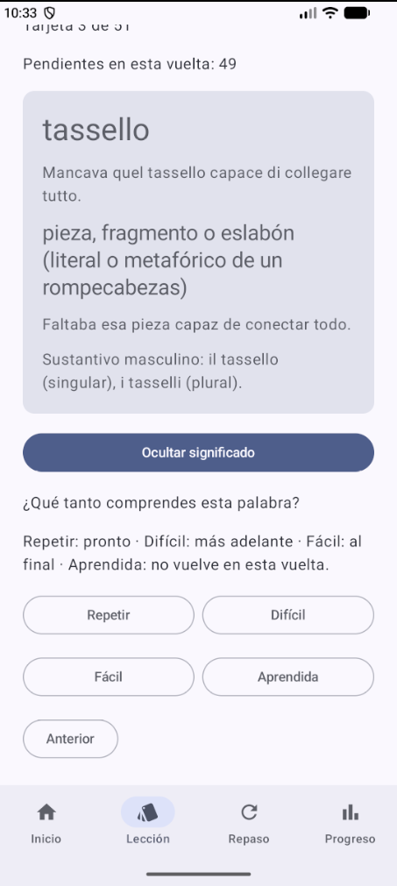

# EmiDiomas

**[manual de usuario en PDF](manual/Manual-EmiDiomas.pdf)**

proyecto para la materia de Desarrollo de aplicaciones móviles, basado en MuffinShop.

la app sirve para practicar italiano con tarjetas y una lectura.
incluye una lección de 51 palabras con traducción al español y una práctica corta de seis palabras que también se puede ver en inglés o francés.

## Cómo se usa

Elige una lección y pulsa Mostrar significado para ver la traducción, el ejemplo y la explicación de la palabra.

después puedes marcar Repetir, Difícil, Fácil o Aprendida.
las tres primeras opciones hacen que la tarjeta vuelva a salir y Aprendida deja de repetirla en esa vuelta.
cuando terminas, puedes abrir la lectura.

en Repaso aparecen las palabras marcadas como Repetir o Difícil, y en Progreso puedes ver cómo vas.
las clasificaciones se guardan en el teléfono.

## Sobre Gemini

La idea era pegar un enlace de YouTube y generar las tarjetas con Gemini.
se hicieron pruebas, pero algunas tardaban demasiado o fallaban por problemas del servicio.
por eso, en esta entrega las lecciones ya vienen cargadas y no se generan tarjetas nuevas.

la lección de 51 palabras se guardó durante las pruebas con [este video en italiano](https://youtu.be/OHnwDV6s9nE) sobre una investigación criminal.

